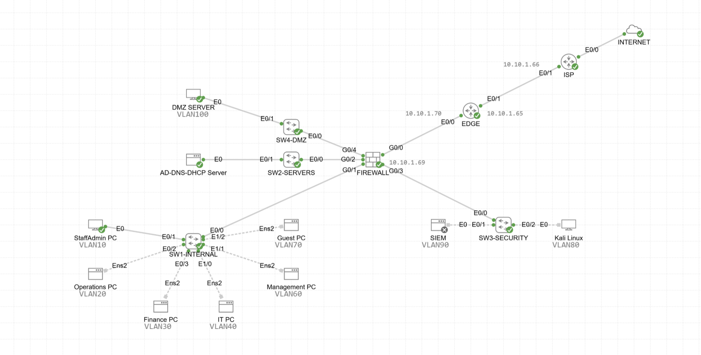

# Vetta Digital | Enterprise Network and Security Lab

I built this Cisco Modeling Labs network for a fictional Melbourne company with 98 employees. I divided the network into ten VLANs, configured routing through the firewall and connected the lab to a simulated ISP.

## Project evidence

- [Network build portfolio](Vetta%20Digital%20-%20Network%20Build%20Portfolio.pdf) includes my subnet calculations, port assignments, live routing tables, NTFS permissions and Group Policy modelling.
- [Client design brief](Vetta-Digital-Client-Design-Brief.pdf) sets out the business requirements.
- [CML topology](Cisco%20CML%20.YAML%20Configuration.yaml) contains an exported lab snapshot. Import it with compatible CML node images and set private credentials before starting the lab. Windows guest data is documented in the portfolio.

## Current progress

I configured Active Directory, DNS, DHCP and departmental file services on one Windows Server VM to fit the available memory. I verified the folder ACLs with icacls and modelled a user policy linked to the Vetta OU. Testing effective file access, verifying policy on a client and demonstrating DMZ isolation are my next milestones.
